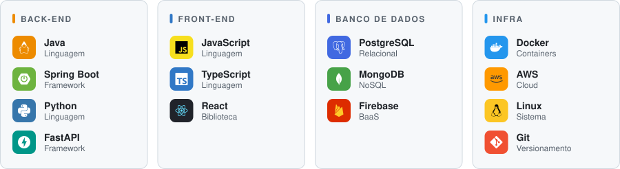

# Gustavo Carvalho

**Assistente de Inovação no Sicredi Norte Sul** &nbsp;|&nbsp; **Desenvolvedor Fullstack**

[![Sicredi Norte Sul](https://img.shields.io/badge/Sicredi_Norte_Sul-Assistente_de_Inovação-00A859?style=for-the-badge&logo=)](#)

---

### Sobre mim

<table>
  <tr>
    <th width="50%">Profissional</th>
    <th width="50%">Pessoal</th>
  </tr>
  <tr>
    <td valign="top">
      <ul>
        <li>Assistente de Inovação no <b>Sicredi Norte Sul</b></li>
        <li>Transformo ideias em protótipos e soluções que funcionam</li>
        <li>Desenvolvimento fullstack, com foco em back-end <b>Java</b> e <b>Python</b></li>
        <li>Cursando <b>Engenharia de Software</b> (6º de 8 semestres)</li>
      </ul>
    </td>
    <td valign="top">
      <ul>
        <li>22 anos, apaixonado por tecnologia desde a infância</li>
        <li>Toco guitarra e curto mexer com áudio</li>
        <li>Fã de games, principalmente da série Zelda</li>
        <li>Usuário de Linux no dia a dia</li>
      </ul>
    </td>
  </tr>
</table>

---

### Stack

---

### Contato

